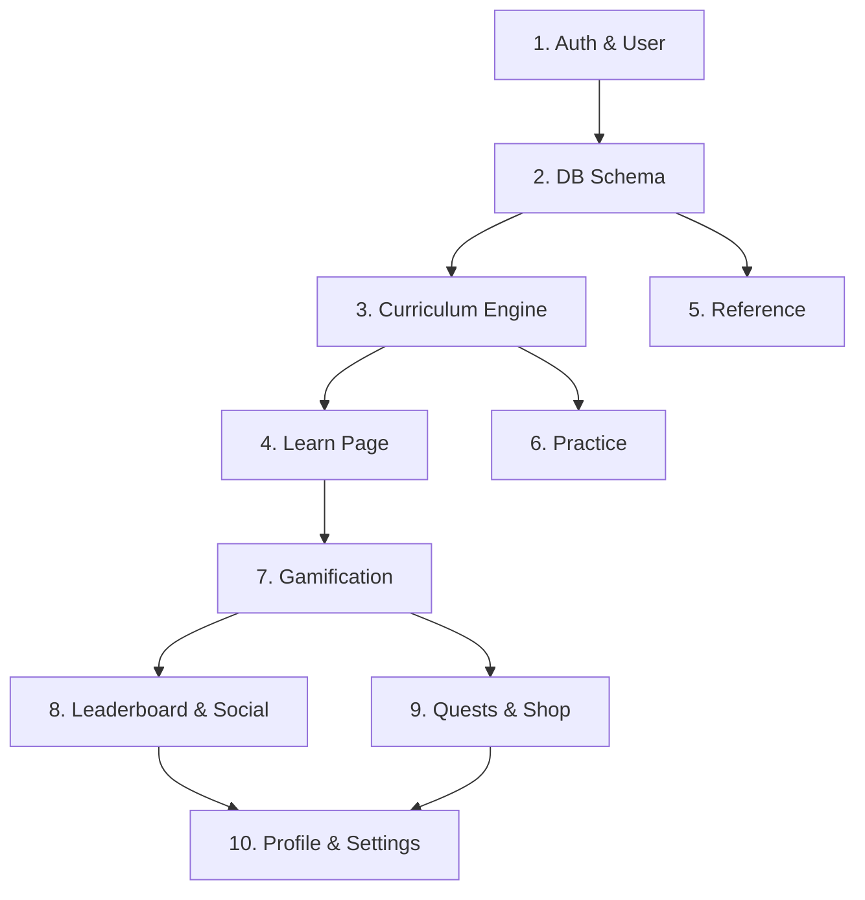

# Qiroasro — Private App Functionality Plan

> Master plan untuk menambahkan fungsionalitas ke Duolingo-like Quran learning app.
> Setiap task besar dipecah ke subtask dan ditrack progressnya di file masing-masing.

## Status Legenda

- `[ ]` Belum dikerjakan
- `[/]` Sedang dikerjakan
- `[x]` Selesai

---

## Reuse `master.sql`

**`docs/schemas/master.sql` bisa dan sebaiknya di-reuse.** Data dari tabel `hij_letters`, `hij_articulation_areas`, `hij_articulation_points`, `hij_traits`, `hij_trait_groups`, serta junction tables (`hij_letter_articulations`, `hij_letter_traits`) merupakan **master data** yang bersifat read-only dan bisa digunakan di mana saja:

| Tabel `master.sql` | Digunakan di Playground | Akan Digunakan di Private App |
|---|---|---|
| `hij_letters` | ✅ Graph nodes | ✅ Learn (lessons), Reference, Practice |
| `hij_articulation_areas` | ✅ Graph nodes | ✅ Learn (units), Reference |
| `hij_articulation_points` | ✅ Graph nodes | ✅ Learn (units), Reference |
| `hij_trait_groups` | ✅ Graph nodes | ✅ Learn (units), Reference |
| `hij_traits` | ✅ Graph nodes | ✅ Learn (units), Reference, Practice |
| `hij_letter_articulations` | ✅ Edges | ✅ Quiz questions, Reference details |
| `hij_letter_traits` | ✅ Edges | ✅ Quiz questions, Reference details |
| `mv_playground_data` | ✅ Single query | ⬜ Buat MV baru khusus private app jika perlu |

Pendekatan: **Tambah Drizzle schema** untuk tabel `master.sql` yang belum ada di `src/db/schema.ts` (saat ini hanya `waitlist` dan `mv_playground_data`).

---

## Tabel dari `unused.sql`

Tabel dari `unused.sql` **bisa digunakan** sebagai berikut:

| Tabel `unused.sql` | Kegunaan di Private App |
|---|---|
| `ref_sources` | Reference page — sumber kitab (Tuhfatul Athfal, dll) |
| `ref_verses` | Reference page — bait/nazam dari kitab |
| `taj_rules` | Learn (sections tajwid), Practice (rule mode), Reference |
| `taj_rule_definitions` | Practice quiz — trigger conditions |
| `taj_rule_citations` | Reference — rujukan per rule |
| `hij_articulation_citations` | Reference — rujukan per makhraj |
| `hij_trait_citations` | Reference — rujukan per sifat |

> [!IMPORTANT]
> `unused.sql` menggunakan `rule_category` ENUM yang masih di-comment-out. Perlu difinalisasi sebelum deploy.

---

## Task Besar — Urutan Pengerjaan

| # | Task | File Plan | Prioritas | Status |
|---|---|---|---|---|
| 1 | Auth & User Management | [01-auth.md](./01-auth.md) | 🔴 Highest | `[/]` In Progress |
| 2 | Drizzle Schema & DB Layer | [02-db-schema.md](./02-db-schema.md) | 🔴 Highest | `[ ]` |
| 3 | Curriculum Engine (Sections, Units, Lessons) | [03-curriculum.md](./03-curriculum.md) | 🔴 High | `[ ]` |
| 4 | Learn Page — Fungsionalitas | [04-learn.md](./04-learn.md) | 🔴 High | `[ ]` |
| 5 | Reference Page — Data Riil | [05-reference.md](./05-reference.md) | 🟡 Medium | `[ ]` |
| 6 | Practice Page — Quiz Engine | [06-practice.md](./06-practice.md) | 🟡 Medium | `[ ]` |
| 7 | Gamification (XP, Hearts, Streak, Gems) | [07-gamification.md](./07-gamification.md) | 🟡 Medium | `[ ]` |
| 8 | Leaderboard & Social | [08-leaderboard-social.md](./08-leaderboard-social.md) | 🟢 Low | `[ ]` |
| 9 | Quests & Shop | [09-quests-shop.md](./09-quests-shop.md) | 🟢 Low | `[ ]` |
| 10 | Profile & Settings | [10-profile-settings.md](./10-profile-settings.md) | 🟢 Low | `[ ]` |

### Dependency Graph

---

## Schema Files yang Akan Ditambahkan

| File | Isi | Status |
|---|---|---|
| `docs/schemas/auth.sql` | Tabel `user_profiles` (auth tables di-manage oleh Better Auth via Drizzle schema) | `[ ]` |
| `docs/schemas/curriculum.sql` | Sections, units, lessons, user progress | `[ ]` |
| `docs/schemas/gamification.sql` | XP, hearts, streak, gems, achievements | `[ ]` |
| `docs/schemas/social.sql` | Follows, leaderboard, activity feed | `[ ]` |
| `docs/schemas/shop.sql` | Shop items, purchases, inventory | `[ ]` |
| `docs/schemas/quest.sql` | Daily/weekly/monthly quests, user quest progress | `[ ]` |

> Tabel dari `master.sql` dan `unused.sql` tetap digunakan as-is (tidak dimodifikasi). Schema baru akan me-reference tabel tersebut via foreign keys.
