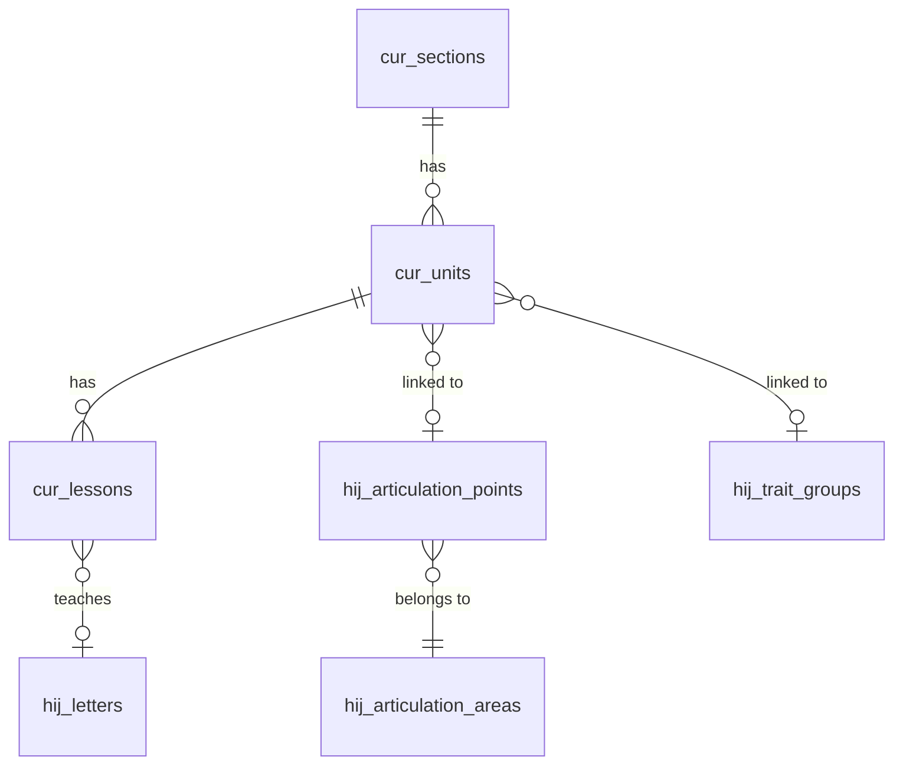

# Task 3: Curriculum Engine

> Sistem yang mengatur urutan belajar: Sections → Units → Lessons, plus tracking progress user.

## Status: `[ ]` Belum dimulai

**Depends on:** Task 1 (Auth), Task 2 (DB Schema)

---

## Konteks

Dari mock data, struktur kurikulum sudah jelas:

```
Section 1: Foundation (Al-Jauf, Al-Halq)
  ├── Unit 1: Huruf Jauf (Mad Letters)
  │   ├── Lesson 1: Alif Mad (ـَا) — lesson
  │   ├── Lesson 2: Waw Mad (ـُو) — lesson
  │   ├── Lesson 3: Practice Review — practice
  │   ├── Lesson 4: Ya Mad (ـِي) — lesson
  │   ├── Lesson 5: Treasure Chest — chest (milestone)
  │   ├── Lesson 6: Bonus Lesson — lesson
  │   └── Lesson 7: Trophy — trophy (unit complete)
  └── Unit 2: Huruf Halq
      ├── Lesson 1: Hamza (ء) — lesson
      └── ...

Section 2: Tongue Letters
  ├── Unit 1: Aqsha Lisan
  └── ...
```

**Key insight:** Units = Articulation Points (makhraj), Lessons = Letters dari point tersebut. Data ini sudah ada di `master.sql`!

## Subtasks

### 3.1 Buat Schema DB — Curriculum
- [ ] Buat `docs/schemas/curriculum.sql`
- [ ] Tabel `cur_sections` (section metadata, linked to makhraj areas)
- [ ] Tabel `cur_units` (unit metadata, linked to articulation points)
- [ ] Tabel `cur_lessons` (lesson metadata, linked to letters)
- [ ] Tabel `cur_user_progress` (user's section/unit/lesson progress)
- [ ] Tabel `cur_user_lesson_results` (individual lesson attempt results)

```sql
-- Contoh schema (akan difinalisasi)
CREATE TABLE cur_sections (
    id INT GENERATED ALWAYS AS IDENTITY PRIMARY KEY,
    slug VARCHAR(50) NOT NULL UNIQUE,
    sort_order INT NOT NULL,
    -- auto-derived from units' articulation areas
);

CREATE TABLE cur_units (
    id INT GENERATED ALWAYS AS IDENTITY PRIMARY KEY,
    section_id INT NOT NULL REFERENCES cur_sections(id),
    articulation_point_id INT REFERENCES hij_articulation_points(id),
    trait_group_id INT REFERENCES hij_trait_groups(id),
    slug VARCHAR(50) NOT NULL UNIQUE,
    color_code VARCHAR(30),
    icon_key VARCHAR(50),
    sort_order INT NOT NULL
);

CREATE TABLE cur_lessons (
    id INT GENERATED ALWAYS AS IDENTITY PRIMARY KEY,
    unit_id INT NOT NULL REFERENCES cur_units(id),
    letter_id INT REFERENCES hij_letters(id),
    type VARCHAR(20) NOT NULL DEFAULT 'lesson',
    -- CHECK (type IN ('lesson', 'practice', 'chest', 'trophy'))
    xp_reward INT NOT NULL DEFAULT 10,
    sort_order INT NOT NULL
);

CREATE TABLE cur_user_progress (
    user_id UUID NOT NULL REFERENCES auth.users(id),
    lesson_id INT NOT NULL REFERENCES cur_lessons(id),
    status VARCHAR(20) NOT NULL DEFAULT 'locked',
    -- CHECK (status IN ('locked', 'available', 'in-progress', 'completed'))
    crowns INT NOT NULL DEFAULT 0,
    completed_at TIMESTAMPTZ,
    PRIMARY KEY (user_id, lesson_id)
);
```

### 3.2 Tambah ke Drizzle ORM
- [ ] Tambah tabel curriculum ke `src/db/schema.ts`
- [ ] Buat Valibot schemas di `src/schemas/curriculum.ts`
- [ ] Buat transformers di `src/models/curriculum.ts`

### 3.3 Seed Data Curriculum
- [ ] Buat `docs/schemas/seed.curriculum.sql`
- [ ] Map sections ke articulation areas dari `master.sql`
- [ ] Map units ke articulation points/trait groups
- [ ] Map lessons ke letters

### 3.4 Services — Curriculum
- [ ] `src/services/curriculum.ts` — Server actions:
  - `getSections(userId)` — Get sections with user progress
  - `getUnits(sectionId, userId)` — Get units with progress
  - `getLessons(unitId, userId)` — Get lessons with progress
  - `startLesson(userId, lessonId)` — Mark lesson as in-progress
  - `completeLesson(userId, lessonId, crowns)` — Complete + unlock next
- [ ] Buat TanStack Query options di `src/app/[locale]/(private)/learn/_queries/`

### 3.5 Unlocking Logic
- [ ] Implement unlock chain: complete lesson → unlock next lesson
- [ ] Complete all lessons in unit → unlock next unit
- [ ] Complete all units in section → unlock next section
- [ ] Milestone lessons (chest, trophy) unlock conditions

### 3.6 Materialized View (Optional Optimization)
- [ ] Evaluasi apakah perlu MV untuk curriculum data (seperti `mv_playground_data`)
- [ ] Jika ya, buat MV yang join sections → units → lessons → letters

---

## New Schema Files

| File | Deskripsi |
|---|---|
| `docs/schemas/curriculum.sql` | Tabel sections, units, lessons, user progress |
| `docs/schemas/seed.curriculum.sql` | Seed data mapping makhraj → curriculum |

## Hubungan dengan `master.sql`


